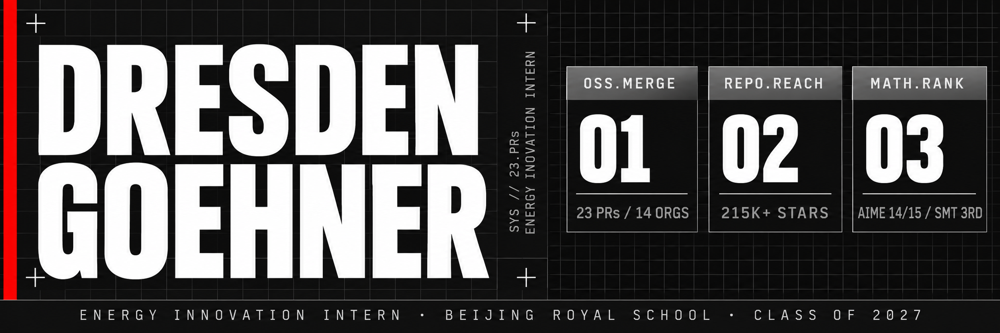

<!-- BANNER — raw SVG embedded as image, renders in GitHub dark theme -->

 

<!-- ═══ QUICK LINKS ═══ -->

&nbsp;
&nbsp;
&nbsp;

 

---

I'm a student developer working at the intersection of **applied mathematics, probabilistic modelling, and scientific open-source engineering**. I build systems that make uncertainty, failure conditions, and provenance explicit — then test whether conclusions hold outside a clean demo.

The common thread across everything I build: **replace impressive-looking outputs with calibrated evidence.**

> *Quantitative Modeling & Data Analysis intern at [Energy Innovation: Policy & Technology LLC](https://energyinnovation.org/) (Summer 2025) — electricity demand forecasting, extreme-weather calibration, tail-risk analysis under Lele Zou.*

 

---

## Mathematics competitions at a glance

| Competition | Result | What it means |
|:--|:--|:--|
| **AIME 2026** (American Invitational Mathematics Examination) | **14 / 15** | Invitation-only second round of the US Math Olympiad pipeline (AMC 10/12 → AIME → USAMO/USAJMO → IMO team). Only a small fraction of AMC 10/12 takers qualify (MAA guarantees at least the top 2.5% of AMC 10 and top 5% of AMC 12). A 14 is approx. top ~2.5% of AIME takers — roughly top ~0.25% of all AMC participants *(approximate, my own estimate)*. |
| **USAJMO 2026** (USA Junior Mathematical Olympiad) | **Qualifier** | Invitation-only USA Junior Math Olympiad — the next stage after AIME. |
| **British Mathematical Olympiad Round 2 (BMO2) 2026** | **27 / 40 — Distinction** · Best in School | BMO2 is the final olympiad round used to select the UK International Mathematical Olympiad (IMO) squad. As an international student I was not officially ranked; based on UKMT's published BMO2 2026 score distribution (8 students scored 26+), my score corresponds to about 8th overall *(international, unranked)*. |
| **Stanford Math Tournament (SMT) 2026** | **Algebra — 3rd place** · Discrete — 7th place | Subject-test placements at one of the largest university-run math contests (~800 in-person competitors; 2,000+ participants globally including SMT Online, per SMT). |

 

---

## Flagship projects

<table>
<tr>
<td width="50%" valign="top">

**[EPSILON — Algorithmic Trading Decision Lab](https://github.com/DresdenGman/EPSILON-trading-simulator)**

Falsifiability-first quantitative research environment. Failure conditions are locked in *before* results appear. Realistic order types, slippage, FFT analysis, robustness diagnostics.

Audited 200+ LightGBM fits — detected leakage, IC dropped 0.94 → 0.10. Strategy rejected.

Diamond Challenge Beijing Regional — 3rd place.

`Python` `Next.js` `FastAPI`

[→ Project](https://github.com/DresdenGman/EPSILON-trading-simulator)

</td>
<td width="50%" valign="top">

**[AI Navigation Glasses](https://github.com/DresdenGman/AIGlasses_for_navigation)**

Low-cost AI glasses for visually impaired users. Multimodal: traffic signals, obstacle detection, voice feedback, computer vision. Safety-first design — low-confidence detections never trigger action commands.

Deployed and donated across three communities; taught older adults to self-assemble devices.

`Computer Vision` `Edge AI` `Raspberry Pi`

[→ Repository](https://github.com/DresdenGman/AIGlasses_for_navigation)

</td>
</tr>
</table>

 

---

## Open-source engineering

**25 external pull requests merged across 16 organizations and maintainers.**

<table>
<tr>
<td align="center"><b>25</b> merged PRs</td>
<td align="center"><b>16</b> organizations &amp; maintainers</td>
<td align="center"><b>17</b> repositories</td>
</tr>
</table>

Contributions to: `HuggingFace/peft` · `langgenius/dify` · `networkx/networkx` · `fairlearn/fairlearn` · `Nixtla/statsforecast` · `Nixtla/neuralforecast` · `SALib/SALib` · `beeware/briefcase` · `scikit-lego` · `scikit-learn-contrib/MAPIE` · `argoproj/argo-cd` · `ag2ai/faststream` · and more

Four representative contributions

| PR | What it did |
|:--|:--|
| [MAPIE #953](https://github.com/scikit-learn-contrib/MAPIE/pull/953) | Added AUROC / AUARC uncertainty metrics; 349 additions across 5 files |
| [Fairlearn #1674](https://github.com/fairlearn/fairlearn/pull/1674) | Confidence-interval support in `plot_metric_frame` via public `MetricFrame` API |
| [NetworkX #8735](https://github.com/networkx/networkx/pull/8735) | Regression-tested warning for ineffective PageRank convergence threshold |
| [BeeWare Briefcase #2939](https://github.com/beeware/briefcase/pull/2939) | Hardened 27 GitHub Actions refs; pinned permissions; zizmor scanning |

[→ Full evidence record with dated methodology](https://github.com/DresdenGman/open-source-contributions)

Case studies: [SALib — six merged PRs](https://github.com/DresdenGman/open-source-case-studies/blob/main/salib-case-study.md) · [StatsForecast — three merged PRs](https://github.com/DresdenGman/open-source-case-studies/blob/main/statsforecast-case-study.md)

 

---

## Research

**PJM Polar-Vortex Load Forecasting** *(in progress)* — Annual 90% interval coverage 82–85%, collapsing to 31–33% during the 2014 cold event. 78,888 point forecasts. Demonstrates how standard annual validation conceals systematic failure during rare extremes.

**The Backtest That Lied** — 200+ LightGBM fits audited. Leakage detection cut information coefficient from 0.94 → 0.10. Strategy rejected after costs and liquidity constraints.

[→ Research notes](https://dresdengoehner.com) · [→ PJM paper repository](https://github.com/DresdenGman/pjm-polar-vortex-paper)

 

---

## Competition results

| Competition | Result |
|:--|:--|
| AIME 2026 | 14 / 15 — Qualification |
| British Mathematical Olympiad Round 2 | 27 / 40 — Distinction · Best in School |
| Stanford Math Tournament 2026 — Algebra | **3rd place** |
| Stanford Math Tournament 2026 — Discrete | **7th place** |
| British Physics Olympiad Round 1 2025–26 | 80 / 100 — Top Gold · Beijing #5 |
| UK Senior Mathematical Challenge | 120 / 125 |
| LSESU Economics Challenge | 97 / 100 |
| World Scholar's Cup Beijing 2025 | Overall Champion Scholar; Senior Team 3rd |

 

---

[dresdengoehner.com](https://dresdengoehner.com) · [evidence archive](https://github.com/DresdenGman/open-source-contributions) · dr.dresden0416@gmail.com

Contribution counts verified via GitHub API, November 2026. Calibration and methodology notes: [evidence record](https://github.com/DresdenGman/open-source-contributions).
