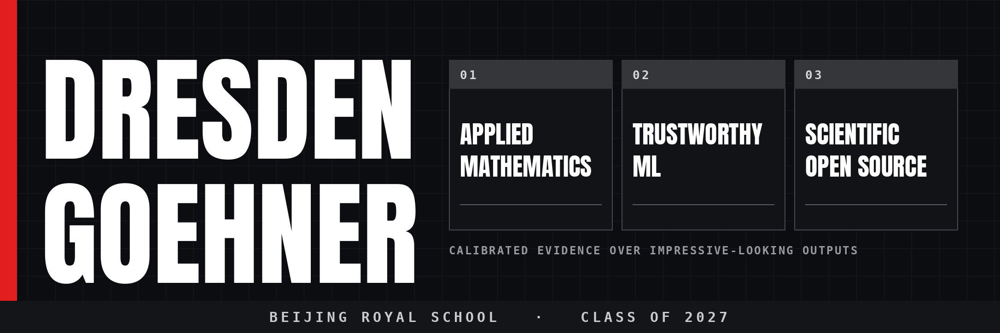

 

&nbsp;
&nbsp;

 

# I build systems that admit when they might be wrong — then test them where they break.

A confident wrong answer is the most dangerous output a system can give, especially to someone who cannot check it. So I look for the places where models and forecasts fail **silently**, and I build things that say "I don't know" instead of guessing.

| **64 people** | **12.5%** | **0.94 → 0.10** |
|:---:|:---:|:---:|
| tried the AI glasses I helped build, taught in 3 communities | actual coverage of "90%" load-forecast intervals during the 2014 polar vortex | information coefficient of my best trading model, after I found the leak and rejected it |

 

---

## 1 · AI Navigation Glasses — a system built to say "uncertain"

Commercial AI glasses cost hundreds of dollars, and most AI sounds equally sure whether it is right or guessing. For someone who cannot double-check with their own eyes, both problems are decisive. This open-source project aims at the opposite: a pair that costs **under US$35** (US$32.29 itemised) and **stays silent or says "uncertain" rather than guess**. Low-confidence detections never trigger guidance.

It builds on an open-source codebase that the repository credits ([AI-FanGe/OpenAIglasses_for_Navigation](https://github.com/AI-FanGe/OpenAIglasses_for_Navigation)). What I developed: the itemised low-cost build, the confidence-gated guidance, the Lifelog app and the community program described below.

<!-- TODO (you): confirm the sentence above matches exactly what you personally built, and add 2–3 sentences
     on WHY you started this (who or what moved you) plus one real quote or moment from a community session.
     This is the human center of the page. -->

- **20** units donated, with accessory kits · **64** people tried them · **85** survey responses (raw data published) · **3** communities taught to assemble their own.
- **The survey also told me what's wrong.** Only 9 of the 64 were still using the glasses, and 48% said prompts were inaccurate or missed something important. Prompt accuracy is now the first thing to fix.
- **450+ stars.** An honest status table separates what is real, what is a demo and what is only planned.

*A research prototype — not a medical device, and not a replacement for a cane, a guide dog or mobility training.*

[→ Repository & build guide](https://github.com/DresdenGman/AIGlasses_for_navigation) · [→ Live Lifelog demo](https://dresdengman.github.io/AIGlasses_for_navigation/)

 

## 2 · Cold-spell forecasting — when "90% confident" means 12.5%

Standard annual validation says a probabilistic load forecast is well calibrated. Then an extreme cold event arrives, and it isn't. I wrote the protocol down **before** computing any results, then tested four PJM extreme-cold events (the 2014 polar vortex, 2017–18 and Winter Storm Elliott, with February 2015 as an official-forecast error anchor) using three forecasters and several conformal-style calibrators.

- **The collapse is real.** A day-ahead 90% interval covered **12.5%** of polar-vortex hours, against 65.7% over the full 2014 evaluation. It replicates in a second, structurally different learner.
- **The obvious repair fails.** Not one of 18 horizon × learner cells restored event coverage to within ±5 points of nominal in at least two of the three events while also meeting the pre-registered width and placebo conditions.
- **Evaluation can flatter the repair.** Leave-one-event-out testing overstated some calibrators' coverage by +11.6 and +21.2 points compared with strict chronological testing.
- PJM's own day-ahead forecasts underestimated the peak of all four events (by 1.3% to 6.6%).

Everything is public and reproducible: pre-registration, code and results.
[→ PJM Cold-Spell Calibration Benchmark](https://github.com/DresdenGman/PJM-Cold-Calibration-Benchmark) · [DOI 10.5281/zenodo.24010850](https://doi.org/10.5281/zenodo.24010850)

 

## 3 · The Backtest That Lied — rejecting my own best result

I built an A-share machine-learning strategy and ran **200+ LightGBM fits** across six experimental phases. The information coefficient looked excellent at **0.94**. It was contemporaneous target leakage. After the fix it fell to **0.10**. A genuine signal remained, concentrated in the least-liquid stocks, and it did not survive costs and realistic execution. I formally terminated the strategy.

> *The signal was real. The strategy was not. Statistical predictability and economic investability are different things.*

A clean negative result is worth more to me than a profitable-looking lie, and I wrote the project up that way.
[→ Interactive write-up](https://dresdengman.github.io/the-backtest-that-lied) · [→ Repository](https://github.com/DresdenGman/the-backtest-that-lied)

**EPSILON** turns that habit into a tool: a decision lab where you state a claim and a rejection rule up front, test nearby assumptions, and keep the evidence even when the claim fails. Its fixed reference case is a recorded **rejection** (0 of 5 perturbations passed), and the public demo is a deterministic synthetic interface, not a performance claim.
[→ EPSILON](https://github.com/DresdenGman/EPSILON-trading-simulator)

 

---

## Open source — depth over count

**29 merged pull requests across 19 third-party repositories**, plus one curated-list entry (counted from GitHub's own records on November 22, 2026; my own projects are excluded). Every pull request, with its file and line counts and the maintainer exchange behind it, is on [my open-source page](https://dresdengoehner.com/contributions.html).

**The 19 repositories I have contributed to have 280K+ combined GitHub stars** (Dify, Argo CD, PEFT, NetworkX, Tornado and others). That is the reach of the projects I worked in, not stars earned by my patches. Stars counted October–November 2026.

What I want you to see is how the work changes in review:

- **SALib — Goda Shapley effects** ([PR #686](https://github.com/SALib/SALib/pull/686), 11 files, +659). A new estimator from a research paper. After discussion with the maintainer, the API keeps raw variance-unit effects and exposes normalised shares separately. The maintainer's final optimisation made it roughly 15–50× faster, and I record that as their work.
- **NetworkX — PageRank tolerance** ([PR #8735](https://github.com/networkx/networkx/pull/8735)). I proposed a warning with tests. Reviewers judged it too much, so I cut the PR down to documentation, and the maintainers improved the wording.
- **MAPIE** ([#953](https://github.com/scikit-learn-contrib/MAPIE/pull/953)): AUROC/AUARC uncertainty metrics · **Fairlearn** ([#1674](https://github.com/fairlearn/fairlearn/pull/1674)): confidence intervals in `plot_metric_frame` · **Briefcase** ([#2939](https://github.com/beeware/briefcase/pull/2939)): CI hardening with zizmor.

[→ Write-ups for selected merges](https://github.com/DresdenGman/open-source-contributions) · [→ Case studies: SALib, StatsForecast](https://github.com/DresdenGman/open-source-case-studies)

 

---

## When I was wrong

Most portfolios list wins. These are mine in the other direction, and each is documented in its repository:

- **A 0.94 information coefficient** that was target leakage. Fixing it and rejecting the strategy is [Project 3](https://github.com/DresdenGman/the-backtest-that-lied).
- **A release I did not promote.** My grid-risk toolkit's v1.4 missed its own predeclared coverage gate (absolute error ≤ 0.03; the Q90 error was 0.035), so I did not ship it as an improvement. [GERT](https://github.com/DresdenGman/Grid-Extreme-Risk-Toolkit-GERT-)
- **A pre-registered criterion I narrowly missed.** The strictest form of my cold-spell collapse hypothesis failed on Winter Storm Elliott, and I report it that way.
- **A PR I shrank.** My NetworkX warning was reduced to documentation after review.
- **Glasses that don't yet work well enough.** Nearly half of surveyed users found the prompts inaccurate, and only 9 of 64 were still using them.

### Engineering & Verification

I am responsible for every change I submit. I use AI tools as a secondary aid, not as a substitute for reading the code or designing the fix.

- **What I own:** choosing which issues to work on, tracing root causes, designing and writing the core fix, running the test suite locally, and replying to maintainer review myself.
- **Where AI is bounded:** searching unfamiliar modules for historical API behavior, expanding repetitive `pytest` parameter tables after I specify the edge cases, and checking derivations and docstrings for slips. Nothing generated enters a commit without line-by-line review and independent verification.

**Calibration in practice:** In [NetworkX #8735](https://github.com/networkx/networkx/pull/8735), my first patch added a runtime warning. A maintainer pointed out that warnings add overhead and are often ignored for a parameter-interpretation issue, so I removed the warning and its tests and reduced the PR to a documentation note, which was then improved by a second maintainer and merged. Knowing when to pull back is part of the work.

 

---

## Competitions

Certificates for each result are on [my proof page](https://dresdengoehner.com/proof.html), which also says which numbers are printed on the certificate and which are my own records.

| | |
|:--|:--|
| **AIME 2026** | 14 / 15 · Qualified · Certificate of Excellence |
| **British Mathematical Olympiad Round 2, 2026** | 27 / 40 · Distinction · Best in School *(international, unranked)* |
| **Stanford Math Tournament 2026** | Algebra 3rd · Discrete 7th |
| **British Physics Olympiad Round 1, 2025–26** | 80 / 100 · Global Top Gold |
| **UK Senior Mathematical Challenge 2025** | 120 / 125 · Gold |
| **LSE Economics Challenge 2025** | 97 / 100 · Top Gold |
| **Diamond Challenge 2026, Semifinal (Beijing)** | Third Prize |

 

---

**Quantitative Modeling & Data Analysis intern, [Energy Innovation: Policy & Technology LLC](https://energyinnovation.org/), summer 2025** — electricity-demand forecasting, extreme-weather calibration and tail-risk analysis.

[dresdengoehner.com](https://dresdengoehner.com) · [proof & provenance](https://dresdengoehner.com/proof.html)

